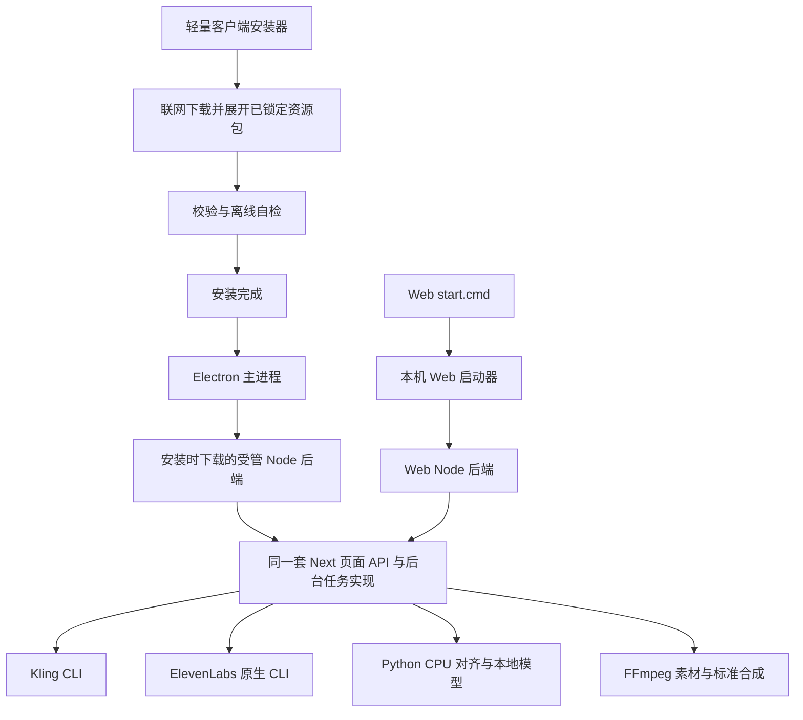

# ClipForge 桌面客户端与 Web 双端适配方案

分析日期：2026-11-10。源码基线：`2a99bf61978b2044d1077d4a3ab0066c2a2b33a1`，应用版本 `0.9.11`。

实施更新：用户已明确选择安装时直接从各自官方来源下载，由安装器自动配置环境。早期方案中的自建 Release 资源包分发已取消；当前流程以 [官方源运行资源规范](desktop-runtime-resources.md) 和 [安装指南](desktop-online-install.md) 为准，无需在本项目 GitHub 托管 CLI、Python 或模型包。

本文是源码分析与实施计划，没有修改业务代码，也没有执行安装、登录、模型生成或付费操作。结论依据当前源码、zhuchaoli 的提交历史、本机依赖元数据和本地 Next.js 16.2.1 文档；安装包在干净机器上的运行结果仍须按本文验收。

## 1. 建议结论

保留现有 React 页面、Next.js API、生成任务、素材管理和合成实现，增加统一运行环境与依赖交付层，使同一套业务同时运行于本机 Web 和 Electron 客户端。

推荐客户端采用 **Electron 窗口 + 安装时在线准备的真实 Node.js 后端 + 在线下载的受管 CLI/Python/模型资源**。Electron 负责窗口、系统交互、配置存储和进程监管；Next.js 和 Kling 都由固定版本的普通 Node 启动。这样可以消除现有桌面服务对 Electron Node ABI 的依赖，降低 Web 与客户端分叉的维护成本。

交付方式固定为轻量在线安装器：安装包包含应用主体、安装引导和资源清单；Node、CLI、Python、模型及媒体工具通过清单在安装过程中联网下载到本机受管目录。上述资源不嵌入客户端安装包，也不制作内置全部资源的离线安装版。构建平台产出的独立资源压缩包用于在线分发，与用户下载的客户端安装包分开。

“装完就能用”的交付标准应当是：**安装过程中完成选定功能所需程序、权重、分词数据、运行库的在线下载、落盘与自检，全部成功后才显示安装完成。正常打开应用不再下载 npm/pip 包或模型。** 后文“离线自检”指下载完成后断开外网验证本地能力，不表示提供离线安装包。首次使用云服务仍由用户登录自己的 Kling / ElevenLabs 账号；安装程序不代替授权，也不触发生成。

第一批正式验收以 Windows 10/11 x64 为主。Windows 11 ARM64 可评估整套 x64 仿真，不能混装 ARM64 Node 与 x64 原生依赖。macOS、Linux 沿用相同架构设计，但按各自 CPU 架构独立制备和验收资源后再标记支持。

## 2. 你的改造范围与保留边界

当前历史中，zhuchaoli 从 2026-10-22 到 2026-11-09 共提交 39 次。与这次适配直接有关的改造如下。

| 提交 | 能力 | 客户端适配含义 |
| --- | --- | --- |
| `9966fb8`、`9abbdc6` | Kling CLI、本机 Web 启动入口 | 将启动器管理的环境变成安装器管理的环境 |
| `91e498c`、`d27eb5c` | 跨项目持久生成队列、关键帧精修任务 | 复用后台任务与恢复能力，补桌面进程生命周期 |
| `571726c`、`e04fd2d` | ElevenLabs CLI 配音及启动器自动安装 | 安装时下载平台原生二进制，接通桌面授权与配音 |
| `2e5bcce`、`998d99d` | 英文真实音频对齐、Komika 字幕、手动标题、原声处理 | 交付 Python/CPU 运行库、权重、NLTK 数据和字体 |
| `1f619ae` | TIDEWE 节奏调整、移除 Kling 独立整片流程 | 仅适配现存单镜头、批量转动态和标准合成 |
| `36986d5` | Kling 批量授权和进度同步 | 保留付费确认、账号绑定与恢复语义 |
| `95d9ea1` | 任务查询优化、图像 checkpoint 文件化 | 迁移时完整保留素材、任务密钥和恢复引用 |
| `2a99bf6` | GPT Image 2.6 生图与精修 | 使用现有 API 实现，随全链路进行桌面回归 |

不恢复 AGENTS.md 已明确移除的 Kling 一键成片 runner、API、规划/合成适配器或 UI。历史数据库迁移和旧任务提交 guard 继续作为兼容记录保留。

“同时支持 Web”首先指保留当前 `start.cmd` 的本机浏览器形态，以及现有普通 Web 业务。项目目前没有完整的远程多用户隔离；远程服务器也无法直接调用访问者电脑上的 CLI。此次不把“客户端适配”扩展为远程多人 SaaS 或浏览器远程控制本机 CLI。

## 3. 已有基础与确定缺口

| 领域 | 当前已有能力 | 需要解决的问题 | 源码证据 |
| --- | --- | --- | --- |
| Electron 壳 | 启动本地 Next standalone；动态端口；日志和失败弹框 | 新增能力没有接入桌面运行链 | `electron/main.js:112`、`:136` |
| 客户端数据 | 数据写入 `userData/data`，与只读程序资源分离 | 未覆盖新增工具、模型、用户配置和旧数据迁移 | `electron/main.js:115`、`:144`；`src/lib/paths.ts:16` |
| Kling 可用性 | 本机 Web 有登录、任务、账号和结果入库 | 明确排除 desktop 和 Electron；后台 runner 同样不会启动 | `src/lib/kling/runtime.ts:2`；`src/instrumentation.ts:6` |
| ElevenLabs 可用性 | 本机 Web 调用原生 CLI，复用 OS 用户 OAuth | 明确拒绝 desktop/Electron 请求 | `src/lib/elevenlabs/local-access.ts:22` |
| Kling 执行环境 | 独立账号 home，受控 subprocess env | 默认 `process.execPath` 在桌面是 ClipForge.exe；环境校验只接受 node/node.exe | `src/lib/kling/profiles.ts:33`；`src/lib/kling/environment.ts:34` |
| CLI 安装 | Web launcher 准备 Kling 0.2.0、ElevenLabs 1.8.0 | Electron 安装和主进程没有相应准备与路径注入 | `scripts/launch-local.mjs:254`；`electron/main.js:138` |
| 音频强制对齐 | 固定英文权重、SHA256、离线 CPU 推理检查 | 运行时仅在源码 `.clipforge` 下准备，缺失时提示运行 start.cmd | `scripts/setup-alignment.mjs:105`；`src/lib/english-alignment.ts:84` |
| 本地 ASR 转写 | 浏览器 Whisper Tiny/Base/Small，WebGPU/WASM | 目前禁用本地模型并允许远程模型；新安装后首次转写仍会联网 | `src/workers/asr.worker.ts:16`；`src/lib/local-asr.ts:3` |
| 业务设置 | Zustand/localStorage 保存服务、声音、模板等 | Electron 与系统浏览器不共享；随机端口还会切换存储 origin | `src/lib/stores/settings-store.ts:188`；`electron/main.js:117` |
| 原生数据库 | 已处理 Electron ABI 的 better-sqlite3 | 桌面脚本原地改写 Web 共用的 standalone，可能破坏后续 Node 启动 | `scripts/bundle-standalone.mjs:49`；`scripts/start-standalone.mjs:1` |
| 媒体工具 | ffmpeg/ffprobe 随包，asar 解包，执行自检 | 只查 `-version`，未保证字幕、混音和转场滤镜齐全 | `electron/media-tools.cjs:6` |
| 安装发布 | electron-builder；Windows NSIS、macOS DMG、Linux AppImage | 尚无新增依赖制备、资源下载、安装完成验收链 | `package.json:75`；`.github/workflows/release.yml:22` |
| 启动验收 | headless smoke 打印 DB 路由结果 | DB 返回错误仍会打印 SMOKE_OK 并退出 0，有假成功可能 | `electron/main.js:205` |
| 桌面生命周期 | 退出时 kill 后端子进程 | 无单实例锁、托盘、完整进程树监管；macOS 关闭窗口后无 activate 重建 | `electron/main.js:169`、`:243` |

以上意味着：单纯放开两个 desktop 判断、或者把本机 `.clipforge` 拷入安装包，都不能完成适配。

## 4. 当前启动链与目标启动链

当前本机 Web：

```text
start.cmd
  → scripts/start-local.ps1：发现或准备 Node
  → scripts/launch-local.mjs：准备 pnpm / npm 依赖 / CLI / Python / 模型
  → 构建和启动 Next standalone
  → 系统浏览器访问 127.0.0.1:3000
```

当前客户端：

```text
Electron main
  → fork Next standalone，使用 Electron 内置 Node
  → 注入 APP_DATA_DIR / APP_MIGRATIONS_DIR / FFmpeg 路径
  → BrowserWindow 访问随机 loopback 端口
  → 新 CLI 集成被 runtime gate 拒绝，模型运行时也未交付
```

推荐目标：



图中的“同一套”指代码复用，默认每个 workspace 只有一个服务进程和一份活动数据；不要求 Web 与桌面两个后端同时写同一数据库。

### 4.1 后端 Node 方案取舍

| 方案 | 收益 | 成本 | 建议 |
| --- | --- | --- | --- |
| 保持 Electron fork 后端，安装时另下载 Node 给 Kling | 保留更多现有启动实现 | 后端 SQLite 仍须 Electron ABI；CLI 又使用另一 Node；维护两套运行时约束 | 可作短期兼容分支，不作为默认方向 |
| 安装时下载固定 Node，运行 Next 与 Kling | 两端后端都是普通 Node；SQLite ABI 与构建 runtime 一致；CLI 默认路径自然正确 | 增加在线 Node 资源管理，调整后端启动和打包脚本 | 推荐 |

桌面选用经验证的 Node 24 LTS，并在资源 manifest 中固定到具体 patch、平台、架构和 hash；PoC 先证明当前依赖兼容后锁定版本。Web 启动器继续保留已支持的 Node 22.13+/24 兼容规则，不强迫源码版用户安装客户端。

`fork()` 改为 `spawn(nodePath, [serverEntry])` 后，同时删除或明确隔离 Electron ABI 替换步骤。不能只替换启动方式而继续把 SQLite 换成 Electron ABI。对被 Next 外部化到 `.next/node_modules` 的副本也要一起核对。

现有 release/CI 使用 Node 22；选择桌面 Node 24 后，桌面依赖安装、原生模块构建和最终 probe 也必须切到同一 Node 24 ABI。仍需验证 Web Node 22 时使用独立构建/制品，不能把 Node 22 构建的 SQLite 直接交给 Node 24。

## 5. 统一运行描述与目录规则

建议新增共享的运行环境描述和 manifest 解析模块，供 Web launcher、桌面安装准备器、Electron main 和后端预检共同使用。具体文件名可在实现中调整，例如：

- `scripts/lib/runtime-manifest.mjs`：读取资源清单、选平台、校验文件。
- `scripts/prepare-runtime.mjs`：构建/安装阶段制备工具和模型，支持 verify/repair。
- `src/lib/runtime-capabilities.ts`：服务端能力状态，区分部署形态、已安装能力和禁用开关。
- `electron/runtime.cjs`、`electron/preload.cjs`：桌面路径和有限系统能力桥接。

建议目录职责：

```text
应用安装目录/resources/             只读程序资源
  standalone/                     Next 服务、前端静态资源、drizzle
  app-runtime.json                此应用版本兼容的资源集合

用户本地受管资源目录/ClipForge/     可由安装器和修复器管理
  runtimes/<runtime-id>/
    node/
    kling/node_modules/@klingai/cli-global/
    elevenlabs/node_modules/@elevenlabs/...
    english-align/python/
    english-align/nltk-data/
  models/<model-id>/<revision>/
  downloads/                      可续传临时文件

app.getPath('userData')/           用户状态，升级保留
  data/                           原有 SQLite、任务密钥、账号、素材、输出、缓存
  settings/                       与端口无关的配置
  logs/
  runtime-state.json              当前资源选择与就绪记录
```

Windows 受管资源优先放 LocalAppData 范围，避免多 GiB 模型进入 Roaming 数据；具体根路径由安装器和 Electron 统一计算并明确传给后端。安装目录、模型目录和业务数据目录不要求处于同一磁盘。

`node.exe`、Python、ElevenLabs、FFmpeg、动态库和权重应处于真实文件系统目录；不要依赖 asar 内部路径执行。安装器以运行应用的目标用户完成资源准备，避免 UAC 提升后把资源或状态装进另一用户目录。

后端至少收到以下明确路径：

| 参数 | 用途 |
| --- | --- |
| `APP_DATA_DIR` | SQLite、任务密钥、素材与输出 |
| `APP_MIGRATIONS_DIR` | 只读迁移目录 |
| `APP_RESOURCE_DIR` | 对齐脚本、字体等业务资源 |
| `APP_ALIGNMENT_RUNTIME_DIR` | Python、分词数据和对齐就绪信息 |
| `CLIPFORGE_KLING_PACKAGE_PATH` | 受管 Kling 包 |
| `CLIPFORGE_ELEVENLABS_PACKAGE_PATH` | ElevenLabs 包及平台二进制 |
| `FFMPEG_PATH` / `FFPROBE_PATH` | 已验收媒体工具 |
| 新增受管 Node / 模型目录描述 | 提供显式 nodePath 与浏览器 ASR 本地资源 |

现有 `english-alignment.ts` 把 Python 写死为 `.venv/Scripts/python.exe` 或 `.venv/bin/python`；需要改为从受管 runtime 描述解析，兼容 Web 原有 venv 布局。模型与 Python 拆目录后，Python runner 和 checker 同样需要显式接收 modelDir，不能仅修改上层路径。

## 6. 安装资源清单

| 资源 | 当前版本/来源 | 安装要求 |
| --- | --- | --- |
| Electron | package.json 声明 `^42.4.1`，实际按 lockfile | 客户端程序主体，按平台架构构建 |
| 普通 Node | 桌面拟固定 Node 24 LTS 的已验证 patch | 安装时下载真实 node executable；不依赖用户 PATH |
| Kling | `@klingai/cli-global@0.2.0` | 安装时下载包及锁定传递依赖，完成运行校验 |
| ElevenLabs | `@elevenlabs/cli@1.8.0` | 在线下载并保留对应 `cli-<platform>-<arch>` optional package；实际调用原生 executable |
| CPython | 拟锁定便携 3.12 的具体 patch | 下载可搬迁资源包，含所需 DLL/运行库，不引用系统 Python |
| 对齐 Python 包 | WhisperX 3.8.6、torch 2.8.0+cpu、torchaudio 2.8.0+cpu、transformers 4.57.6 等 | 预构建到在线 Python 资源包；锁定全部传递依赖、wheel hash 与平台/Python ABI |
| 英文对齐模型 | `facebook/wav2vec2-base-960h` | 安装时下载；固定 revision `22aad52d435eb6dbaf354bdad9b0da84ce7d6156` 和已有六文件 SHA256 |
| NLTK 分词数据 | 当前使用 `punkt_tab/english` | 补充版本、来源和 hash，安装时下载，运行时不再 nltk.download |
| FFmpeg / FFprobe | 当前 npm 平台包 | 纳入安装时在线资源下载；核验架构、执行权限、所需滤镜/编码器和真实短片渲染 |
| 字体 | Komika Axis、Noto CJK 等实际使用字体 | 随只读资源交付；真实渲染验证字体命中 |
| 浏览器 ASR | Whisper timestamped Tiny/Base/Small | 按安装选择交付 ONNX、配置、tokenizer 和匹配的 WASM runtime |

清单需包含：资源 ID、版本、源 URL、目标 OS/arch、Python/Node ABI、压缩大小、展开大小、SHA256、必要文件、兼容应用范围、来源和许可材料、探测命令。资源清单本身随受信任应用制品固定，校验值不能只依赖同一不受控下载端返回。

### 6.1 当前本机体积测量与优化边界

本次对现有工具目录做了只读统计：

| 内容 | 当前本机展开体积 |
| --- | ---: |
| Kling 本地安装目录 | 约 0.7 MiB |
| ElevenLabs 本地安装目录 | 约 16.5 MiB |
| 英文对齐运行时合计 | 约 3,636.8 MiB，即 3.55 GiB |
| 其中 Python venv | 约 3,276.5 MiB |
| 其中对齐模型 | 约 360.1 MiB |

这是当前开发机目录的展开大小，不是未来安装包大小，也不包括完整客户端和所有 ASR 档位。这些大型运行资源通过安装过程在线下载，不计入客户端安装包；用户仍需准备相应下载流量和安装磁盘空间。

已核对 torch 为 `2.8.0+cpu`，不是误装 CUDA。较大的部分来自 Windows torch 包内约 2,643.6 MiB 的 `.lib` 链接库，DLL 合计约 269.2 MiB。可以研究去除仅构建时使用的静态链接库、头文件和测试资料，但必须用完整 CPU 对齐、迁移目录和打包短片回归证明；首次适配不应以未经验证的瘦身作为成功前提。

下载体积、展开体积、临时空间和升级时两版本并存空间应由 manifest 算出。安装界面据此显示磁盘要求，不预先承诺“几十 MB 小安装包”。

### 6.2 Python 必须可搬迁

当前 `.venv/pyvenv.cfg` 引用了开发机的系统 Python 路径；直接压缩该目录在无 Python 的电脑上无法保证运行。

首选做法：CI 下载固定 patch/hash 的可搬迁 CPython 发行版，按目标平台把已锁定 wheel 安装进该发行版自己的 site-packages，形成完整资源包。构建时可使用受控 wheelhouse；终端用户安装时只下载/展开/校验此包，不访问 PyPI 求解依赖。

备选做法：安装器在线下载便携 Python 和已锁定 wheelhouse，在最终目录创建 venv 后使用 `--no-index` 本地安装所下载的 wheels。Python 与 wheelhouse 均为独立在线资源，不进入客户端安装包；这种方式的安装时间、临时空间和失败处理更多，因此优先采用预构建资源包。

两种做法都必须在不同磁盘、中文/空格路径、没有开发机 Python 的环境实际执行。`ready.json` 由安装后本机 probe 生成，不把开发机 ready 标记当作目标机验收结果。CPU 运行库、Visual C++ runtime 或便携 Python 所需系统最低版本一并由干净机器测试确认并纳入安装依赖。

### 6.3 浏览器转写模型也要处理

Python wav2vec2 强制对齐与浏览器 Whisper 转写是两套系统：前者对齐已知英文文案，后者识别导入音频。不能互相替代，也不能仅装前者就宣称所有本地语音功能离线可用。

建议安装器提供明确的“本地转写模型”选择。默认安装一档已验证模型，包含 WebGPU fp32 encoder/q4 decoder 及 WASM q8 兜底所需文件；用户选择更多档位时在安装完成前全部下载。未安装档位应在 UI 标记为未安装并进入显式资源管理流程，不在用户点击转写后暗中下载。若要求现有 Tiny/Base/Small 三档全都立即可用，则三档的所有实际文件都列为安装必选。

桌面 worker 改为从受控本地 HTTP 路径读取模型和 ONNX/WASM 资产，禁用远程回退。资源接口只允许已登记模型与文件，不能成为任意文件读取接口。Web 模式保留当前远程下载/浏览器缓存方式，并可选使用同一受管模型目录。

## 7. 安装交付流程

### 7.1 Windows 轻量在线安装器

仅采用在线安装交付。客户端安装包与资源包分别发布：前者包含 Electron/Next 应用、bootstrap helper 和固定 manifest，后者按 OS/arch/version 在线提供 Node、CLI、Python、模型及媒体工具。安装包不包含这些资源的副本，Electron 内置的 Node 仍仅属于 Electron 本身。

安装器自动选择资源并显示总下载量、进度与预计磁盘占用，用户无需到不同网站手动下载。已完整安装且 hash/版本匹配的资源可复用，升级只补充新增或变化的资源；应用安装包大小不随模型资源增长。

安装过程：

```text
检查 OS/CPU/权限/磁盘与旧版进程
→ 读取本次安装固定的资源清单
→ 下载临时文件，显示总量与单资源进度
→ 校验大小和 SHA256，校验解压路径
→ 展开至版本化 staging 目录
→ 检查 Node / 两个 CLI 版本 / Python imports / FFmpeg filters
→ 禁止外网访问，执行模型 CPU 推理及本地短片字幕渲染
→ 记录资源就绪信息，原子切换当前 runtime
→ 完成安装，可直接打开客户端
```

可以使用 NSIS 自定义安装步骤调用专门 bootstrap helper，但必须真正等待 helper 成功并检查退出码。不能仅弹出一个下载程序就把安装器标记成功；也不能把所有下载推迟到首次正常打开客户端。

安装与升级自检使用隔离的临时 `APP_DATA_DIR`，不打开或迁移用户正在使用的真实数据库。引入显式 probe 模式，在自检服务中禁用 generation/Kling runner；模型、CLI 版本和短片渲染可在无账号、无历史任务的夹具环境完成。只有用户正式启动应用并通过预检后，才按既有授权规则恢复真实工作区队列。

下载失败提供重试、取消或切换受信任镜像；支持服务器允许的 Range 续传，结合 ETag/版本和最终 hash 避免拼接错资源。暂时断网时保留已下载进度并等待重试，不跳过资源准备而显示安装成功。取消或校验失败不生成 ready 标记；旧版本仍可用。资源修复只操作本应用登记的目录，不覆盖用户项目和账号目录。

### 7.2 macOS 和 Linux 的实际交付差异

DMG 拖拽安装和 AppImage 本身没有 Windows NSIS 那样的安装阶段，因此后续支持这两个平台时，需要提供独立的在线安装 helper 或明确的安装准备向导，统一下载资源到受管目录。向导仍属于安装流程，资源未准备完成前不能进入正常业务界面或显示安装完成；DMG/AppImage 同样不内置 CLI、Python 和模型资源。不能将正常使用过程中临时下载模型描述为已完成安装。

每个平台独立确认 Python、PyTorch CPU wheels、ElevenLabs、FFmpeg 和 SQLite 制品可用性；不同 CPU 架构不共用二进制。签名/公证、执行权限和应用包内嵌套二进制的签名按最终资源布局处理。

## 8. 两个 CLI 接入的具体改造

### 8.1 Kling

- 将 `isKlingRuntimeEnabled()` 从“不是桌面”改为受支持本机 runtime 的能力判断，保留显式禁用开关。
- `instrumentation.ts` 在资源就绪的 desktop-local / local-web 环境启动现有 Kling runner。
- 安装器和 Electron 注入固定 Node、包路径；profile 创建时自动采用受管路径。普通用户无需填写 node.exe 和 npm 包目录。
- 区分受管安装与用户显式自定义路径。升级只重新绑定受管路径，不擅自覆盖用户自定义路径。
- 继续使用真实 Node 启动 CLI，不用 ClipForge.exe 伪装 node，也不向受控 CLI 环境硬塞 Electron 特殊开关。
- 保留 profile 独立 home、账号指纹、登录会话、锁、受理回执和结果导入机制。
- 登录授权使用系统浏览器，保留 CLI 自身 OAuth/PKCE 与本地回调方式。桌面拦截外链时使用当前已验证的官方授权 URL 规则。
- 单镜头、批量转动态、重启查询和失败后恢复保存全部沿用现有实现；付费提交状态未知时仍不得自动重买。

### 8.2 ElevenLabs

- 将 local-access 中的 desktop/Electron 禁用转换为同样的本机能力策略。
- 安装与升级验证 wrapper 和对应平台包版本一致，直接执行原生二进制，保持 Windows 隐藏终端行为。
- 通过受管路径定位，避免桌面版无意选中全局 npm/npx 缓存中的其他版本。源码版显式覆盖能力继续保留。
- 保留当前系统用户身份和 OS 凭据库环境。安装包不携带 OAuth token，安装器不登录，不复制开发者授权。
- 使用独立工作目录并继续过滤 `.env`/API endpoint 等环境覆盖，不改变现有 OAuth 优先行为。
- 声音目录、试听、项目声音选择、真实配音合成和缓存分别回归；生成失败仍不静默切换微软声音或自动重试可能已计费请求。

CLI 已安装、已授权、账号可用额度、模型/声音可用是不同状态。客户端设置页显示可理解的状态和重新授权入口，不把“安装完成”显示成“账号已登录”。

## 9. 业务数据、配置与 Web 迁移

### 9.1 持久配置不能继续依赖随机端口

默认保留 loopback HTTP 和动态端口，配置改为与 origin 无关的持久存储。仅固定端口不能彻底解决问题：端口会冲突，系统浏览器与 Electron 的 profile 也不同。

建议为 Zustand persist 和直接 localStorage 调用增加统一 storage adapter：Web 维持浏览器存储；桌面通过有限 preload/IPC 桥访问 `userData/settings`，以 workspace/profile 为作用域。保留已有设置版本与 migrate 逻辑，处理异步 hydration 后再启动依赖设置的 UI 请求。

覆盖范围不能只包含全局设置，还包括：

- `settings-store` 的 provider、LLM、TTS 和语言等配置。
- `brand-store`、`product-library-store`、`template-store`、`project-store` 实际持久化的用户资料。
- `project/[id]/video/page.tsx` 的项目配音选择、广告模板选择与已应用标记。
- 需要长期保存的 UI 偏好；纯临时 session 数据可继续使用浏览器存储。

敏感配置由桌面主进程使用 safeStorage/OS 凭据机制保护持久化；不得把解密接口扩展成任意文件/系统访问。短期若仍沿用当前前端传 API key 的请求协议，应明确 renderer 仍会接触密钥，不能仅因磁盘加密就声称密钥完全留在后端。将 provider 调用彻底改为后端凭据引用可作为后续独立改造。

### 9.2 从当前源码 Web 迁移

提供“导入旧版工作目录”和 Web 配置导出/导入，而不是假定客户端会自动读取系统浏览器。

1. 停止旧服务和旧任务领取，检查 workspace 所有权锁，保留原目录备份。
2. 正确关闭/备份 SQLite 并处理 WAL，迁移完整 `data`：数据库、`generation-task.key`、uploads、output、integrations、恢复输入与必要缓存。
3. 保留现有 ID、账号绑定、任务回执和加密密钥；缺少 key 时报告不可恢复项，不生成新 key 后假装历史 checkpoint 可读。
4. 审核 schema、输出、Kling profile 和任务快照中的绝对路径，将受管工具路径重新绑定，将工作区内资产路径按映射重定位；用户选择的外部素材路径单独确认可用性。
5. 加密快照仅通过现有解密/校验接口迁移必要字段，不能做全库字符串替换。已受理任务的账号、参数、签名与原始回执不可被新默认设置覆盖。
6. 验证旧项目图片、视频、历史版本、当前镜头选择和任务恢复成功后，再标记迁移完成；失败回滚保留旧数据。
7. 在旧 Web 中导出配置到用户选择文件，再由客户端导入。包含敏感设置时应明确并保护导出文件；账号 OAuth 默认重新验证或重新登录。

`generation-task.key` 是任务 checkpoint 的 AES-256-GCM 密钥，位于数据根目录（`src/lib/generation-secrets.ts`）。只复制 sqlite.db 不足以迁移任务。

首版不允许两个独立后端无提示地共用同一 workspace。桌面自身使用 single-instance lock，再加 workspace 服务所有权锁，防止 Web 与桌面争用数据库和突破进程内并发限制。若用户希望用系统浏览器访问客户端，可直接打开客户端已运行的同一个本地服务，复用该服务的任务与数据；浏览器 UI 配置是否同步则由明确的配置接口或导入机制处理。

## 10. 桌面生命周期与本地交互

| 场景 | 建议行为 |
| --- | --- |
| 点击关闭窗口 | 默认隐藏到托盘并保持任务运行，首次明确说明；提供“彻底退出” |
| 彻底退出 | 停止领取新任务，保存当前状态，通知后端退出，等待有界清理，再处理本应用子进程 |
| 已受理云任务 | 退出不宣称取消云端生成；重启按原编号查询/入库 |
| 正在 FFmpeg 合成 | 明确提示会中断，及时记录中断状态，重新打开后可手动重试 |
| 休眠与恢复 | 恢复后刷新健康状态、CLI 会话、租约与云任务；不重复提交未知付费请求 |
| 后端崩溃 | 展示故障和日志入口，有限次数重启；不得无限重启或借重启再次购买生成 |
| 重复打开客户端 | 激活已有实例，不创建第二套 runner |
| macOS 再激活 | 正确重建窗口，确认后端仍在；修复当前关窗后无 activate 的空状态 |
| 资源修复/升级 | 先释放对应进程和文件，再切换版本，失败保留旧 runtime |

现有持久 generation runner 已有租约和 checkpoint，应复用；但合成与部分 pipeline 仍依赖进程内 `void async` 任务（`src/app/api/project/[id]/compose/route.ts`、`src/lib/pipeline-runner.ts`）。数据库启动仅对超过 15 分钟的旧 composing 记录清理，不能承诺当前所有合成均可自动续跑。首版至少提供退出提醒、进程清理和即时中断标记；完整合成持久队列可后续实施。

进程管理需覆盖 Next → Kling / ElevenLabs / Python / FFmpeg 的进程树。优先使用受控取消/IPC shutdown；Windows 必要时用 Job Object 或受控进程树终止，不能按通用进程名清理其他应用。

普通 `spawn` 不自动具备原 `fork` 的 IPC 行为；若使用 IPC 退出协议，需要显式建立受控通道与握手。启动探针通过 `/api/health` 核对本次随机 instanceId、数据库、迁移与资源状态，避免仅凭端口可访问就认错服务。保持 Windows GUI 下现有文件描述符日志方案，不退回无效的 `stdio: inherit`；每次启动同步注入真实应用版本，避免普通 Node 后端显示 unknown。

桌面文件导入继续复用现有 HTTP 上传；媒体播放继续走 `/api/files`、`/api/output` 的范围请求与根目录约束，不转成任意 `file://`。补齐下载保存位置、在文件夹中显示、剪贴板和外链操作。主窗口限制为本应用 origin，外部网站交系统浏览器；preload 只暴露必要动作并验证来源。

## 11. 保留本机安全边界和 Web 兼容

两个 CLI 当前的 Host/Origin/Fetch-Site、本机会话 cookie、CSRF 和 JSON 检查可继续保护 Electron 本地 HTTP 页面。放开 desktop 应通过后端本机能力判断实现，不能删除这些保护或把允许来源改成通配符。

Electron 显式保持 contextIsolation、renderer 禁用 Node、sandbox 等设置；处理 `setWindowOpenHandler` / `will-navigate`，限制官方 OAuth URL 与普通外链的打开方式。不因下载模型而关闭 webSecurity 或开放任意本地文件读取。

新增桌面管理接口不应直接继承 `src/proxy.ts` 对任意 localhost 端口的 CORS 便利策略，必须使用专用校验或有限 IPC。现有 CLI/MCP/Infinite Canvas 与内部 self-fetch 不应被未经适配的全局桌面 token 拦截；如果后续引入服务 token，需同步调整这些调用链。

Web 回归要求：

- `start.cmd` 双击安装/启动、`--check`、`--no-browser`、端口占用和中文路径行为继续可用。
- `pnpm dev`、`pnpm build`、`pnpm start` 保留普通 Node 运行路径。
- 新增 Electron-only import 不能进入普通 Web 服务或浏览器 bundle。
- 本机 Web 的两个 CLI、本地对齐、字幕和任务恢复照常可用。
- Docker/远程 Web 不因桌面适配而自动启用访问者本地 CLI；若要在容器使用本地对齐，需另行明确镜像资源交付，不假装当前 Dockerfile 已包含 Python/模型。
- 本次不改写模型、TIDEWE 文案节奏或付费授权规则，不恢复 Kling 独立成片。

## 12. 构建、打包和发布调整

当前 `.next/standalone` 同时服务 Web 和 Electron，桌面 bundle 还会修改其中 SQLite ABI。必须在干净构建后生成独立 staging：

```text
artifacts/web/<platform>-<arch>/
artifacts/desktop/<platform>-<arch>/standalone/
artifacts/runtime/<runtime-id>/
artifacts/manifests/<app-version>.json
```

构建器依赖与安装时下载的固定 Node 必须匹配所需原生 ABI；优先在对应目标 OS/arch runner 原生构建，而不是修改架构标签伪装跨平台包。所有 Next 生成的外部化原生模块副本都进入产物检查。

Electron 安装制品只收集应用 staging；`artifacts/runtime` 和模型压缩包作为独立在线资源发布到清单登记的地址，不被 electron-builder 的 files、extraResources 或 afterPack 再次复制进应用包。现有 FFmpeg/FFprobe 随包配置也改为受管下载路径。CI 应检查最终安装包中没有 Node 独立发行版、CLI、Python、模型权重或资源压缩包的重复副本。

| 文件/模块 | 计划修改 |
| --- | --- |
| `package.json` | 区分 Web、desktop staging、资源制备/校验、安装包构建命令；安装包排除独立在线资源 |
| `scripts/bundle-standalone.mjs` | 拆开静态资源补齐与 runtime ABI 处理，不再污染 `.next/standalone` |
| `scripts/start-standalone.mjs` | 保持 Web 入口，复用共享路径定义，校验普通 Node 原生依赖 |
| `scripts/launch-local.mjs` / `setup-alignment.mjs` | 逐步复用 manifest、版本和 probe；保留源码版 bootstrap，不直接把整个 launcher 变成桌面入口 |
| `next.config.ts` | 保持 standalone 与用户目录 tracing 排除；精确包含脚本、字体和必要资源，不取消 `.clipforge` 排除 |
| `electron/main.js` | 固定 Node spawn、能力注入、单实例、托盘、后端监管、窗口/下载/外链处理 |
| `electron/after-pack.cjs` | 仅复制应用 staging，检查资源清单与应用完整性，保留 Next peer dependency 检查；不复制在线资源 |
| `electron/media-tools.cjs` | 改为校验在线安装的媒体工具路径；从版本探测扩展为 filter/codec 与真实渲染验收 |
| `src/lib/kling/*` / `elevenlabs/*` | 桌面本机能力、受管安装默认值、授权和错误文案 |
| `src/lib/english-alignment.ts` / Python runner | 可搬迁 Python 与模型目录解析；按 runtime 版本 probe |
| `src/workers/asr.worker.ts` | desktop 本地模型与 WASM 解析、禁用隐式远程下载 |
| stores 与直接 localStorage 调用 | 引入跨 origin 桌面 storage adapter，提供迁移导入 |
| `/api/health` 与 desktop smoke | 汇总安装状态；真正失败时非零退出，不打印成功 |
| `.github/workflows/release.yml` | 目标 OS/arch、独立资源制备和在线发布、下载可达性、安装验收、制品 hash；不合并进安装包 |
| `.github/workflows/ci.yml` | Web 与 desktop runtime 兼容矩阵；显式对齐桌面 Node/native ABI |
| README、启动器/CLI 文档 | 删除“桌面暂不支持”旧限制，改为实际支持矩阵和安装说明 |

本地 Next.js 16.2.1 `output.md` 已明确 standalone 不自动复制 public 和 `.next/static`，也不能保证动态运行资源完整；需要保留显式补齐与制品检查。`instrumentation` 在服务就绪前执行，适合启动既有 runner，不适合承载数 GiB 的隐式下载。

不能把开发机 `.clipforge`、data、日志、浏览器 profile、`.env`、账号凭据或用户生成内容作为打包输入。用白名单收集新建的构建资源目录，并检查最终制品。

当前没有自动更新实现。第一版先确保安装器覆盖升级、数据备份与资源版本切换可靠；应用内自动更新可以单独安排。DB schema 升级前备份，程序回滚与数据库回滚分开处理，不能用旧程序直接打开不兼容的新 schema。

### 12.1 在线资源的来源与许可材料

发布前建立第三方 notices 和来源记录：项目为 AGPL-3.0-only；ElevenLabs 本机包带 MIT；torch/WhisperX/Transformers 等有各自许可。当前 Kling 包缺少 license 字段和实际 LICENSE 文件，模型六文件目录未携带模型卡，Komika 的本地材料也不足以直接证明再分发条件，需要补齐官方材料，并为每项在线资源确定使用官方固定下载源还是允许分发的受管镜像。资源是否可以再分发影响下载源选择，不改变安装过程中在线获取的交付方式。

FFprobe 外层 wrapper 与实际 Windows 平台二进制的许可不同，FFmpeg 本机包启用了 GPL/version3，notices 应按真实分发二进制收集。此项针对实际要发布的资源，不以 npm wrapper 名称替代底层许可证核对；完成后再锁定正式分发清单。

## 13. 实施阶段与交付物

| 阶段 | 主要内容 | 完成标准 | 参考工作量 |
| --- | --- | --- | --- |
| A：架构验证 | 固定 Node 启动 packaged Next；SQLite/两个 CLI/对齐最小链；明确平台资源布局 | unpacked app 在没有全局 Node/Python 的机器运行，不经过 Electron SQLite ABI 替换 | 2–3 人日 |
| B：受管资源 | 锁版本/hash；构建便携 Python；CLI/模型/NLTK/WASM 清单和 probes | 所选资源移到新磁盘中文路径后仍可离线运行 | 3–5 人日 |
| C：安装器 | Windows 在线下载/展开/校验/续传/修复；安装完成门槛 | 安装包不含大型资源；依赖下载失败不能显示安装成功；下载完成后禁网自检通过 | 3–5 人日 |
| D：配置与迁移 | storage adapter、全局/项目配置；旧 data 与工具路径迁移 | 重启、端口变化、覆盖升级不丢设置；旧项目和任务完整可读 | 2–4 人日 |
| E：桌面交互 | OAuth 外链、托盘、单实例、退出/休眠/进程树、下载 | 关窗继续任务；退出中断可解释；已付费任务不重复提交 | 2–3 人日 |
| F：全链验收发布 | 干净 VM、Web 回归、断网、故障/升级矩阵；发布说明 | 验收矩阵全部通过，发布可复现的签名/校验制品 | 3–5 人日 |

Windows 完整首版初步约 15–25 人日，部分工作可并行。这是分析后的排期量级，不是已验证的交付承诺；跨平台资源可用性、Python 瘦身、签名与旧数据兼容样本会影响实际时间。macOS/Linux 正式验收、完整合成持久化和自动更新另排，不混入“简单打包”的估算。

建议先交付 A 阶段技术验证，再落实大体积资源与 NSIS 安装流程；避免先做安装 UI，最后发现 runtime 不可搬迁。

## 14. 验收矩阵

| 场景 | 必须看到的结果 |
| --- | --- |
| 干净 Windows 普通用户，无 Node/Python/npm/pip/Git/FFmpeg | 从安装程序完成安装并启动；不要求用户打开终端 |
| 安装完成后断开外网 | Node/SQLite、对齐真实音频、字幕渲染、本地 ASR 已选档位不再下载程序和模型 |
| 联网首次使用 | 两个 CLI 各自 OAuth 登录；声音/模型列表正确；安装器没有代登录或提交生成 |
| Kling 单镜头与批量动态 | 使用确认的账号/模型/起止帧生成；结果进素材库并进入标准合成 |
| Kling 退出/重启/未知受理 | 有编号的任务原编号查询保存；未知受理不自动重购；授权边界保持 |
| ElevenLabs 试听与合成 | 使用选定声音和模型；缓存正常；失败不偷偷换声音或重买 |
| 字幕与标题 | 实际使用的口播音轨对齐；Komika 单行高亮样式保持；标题开关和文案独立 |
| 原声与配音模式 | TIDEWE 原声、配音、关闭字幕等组合保持原业务行为 |
| 本地 ASR | WebGPU 工作；不可用时 WASM 兜底；选定模型两套实际权重齐全 |
| 重启与端口变化 | provider、TTS、模板、商品库、项目配音和语言等配置仍存在 |
| 中文/空格/长路径、另一个磁盘 | 程序/模型/素材调用不因 shell 引号或绝对路径失效 |
| 下载中断、hash 错误、空间不足 | 安装保留可重试状态；无错误 ready 标记；旧版不被破坏 |
| 安装包内容与资源发布 | 安装包不含 CLI/Python/模型和独立 Node/媒体资源副本；在线地址按版本固定、可下载且 hash 匹配 |
| 升级与迁移 | 项目、账号配置、密钥、任务、素材、成片保留；工具绝对路径重绑定 |
| 重复启动及 Web 同目录争用 | 单实例/服务锁明确处理，不能出现两套后台队列偷偷同时运行 |
| 关窗、退出、休眠、杀后端 | 无本应用孤儿进程；任务状态可解释；重启恢复符合实际能力 |
| 健康检查故意注入 DB/资源故障 | smoke 返回非零，安装或发布检查失败，不能输出 SMOKE_OK |
| FFmpeg 真正短片 | 字体、drawtext/ass/subtitles、转场、音频混合和编码均可执行 |
| Web 回归 | start.cmd、dev/build/start、本机两个 CLI、任务中心和标准合成继续可用 |
| 外部网页/非法本地请求 | CLI 同源和 CSRF 边界保持，主窗口不能导航到任意外站 |

日常 CI 继续执行现有 lint/test/build，并新增针对能力判断、storage adapter、manifest 和迁移的必要回归。真实 native/模型/安装烟测放在对应平台集成流水线；付费云端 E2E 使用受控专用账号和明确测试预算，不在每个 PR 自动生成。

## 15. 首版必须完成与后续可排内容

**首版完成条件：** 轻量安装包不内置 CLI/Python/模型资源；两个 CLI 的桌面能力与授权接通；真实 Node 和可搬迁 Python 在安装过程中在线下载；安装阶段全部选定资源就绪；强制对齐与所选本地转写离线可用；配置不受端口影响；完整旧数据迁移；单实例和退出行为清楚；Web 回归；干净 Windows 安装验收通过。

**随后单独实施：** 合成/全流程持久队列、更多 ASR 模型档位、macOS/Linux 正式支持、自动更新、经过验收的运行时瘦身、跨端设置同步。未安装模型必须明确显示状态，不能继续以“全部可用”掩盖安装后下载。

整个适配应围绕运行环境和交付展开，复用你已经实现的生成、配音、对齐和合成逻辑。最关键的第一步是证明：一台没有开发环境的电脑，通过轻量安装器在线下载并准备运行资源，安装完成后即可执行现有业务。
